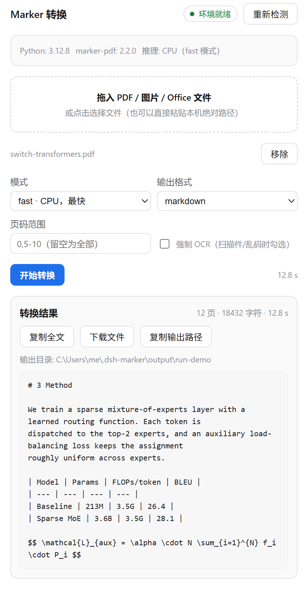

# Marker 文档转换 · DSH 插件

[](LICENSE)
[](https://github.com/datalab-to/marker)

把 [datalab Marker](https://github.com/datalab-to/marker) 接进 DeepSeek Harness：在 **右侧栏**里拖入 PDF / 图片 / Office 文件，转成 Markdown、JSON、HTML 或 chunks，并就地预览、复制、下载。



## 一键安装

在 DSH 的 **Plugins → Add plugin** 里粘贴这一行（直接从 GitHub 装，走 git 规格）：

```
github:TheodoreYan977/_dsh_marker
```

或者直接对 DSH 里的 Agent 说一句：

> 装一下这个 DSH 插件：`github:TheodoreYan977/_dsh_marker`

装完 **刷新一次页面**（客户端插件要重新拉模块），然后：

- 右侧栏「+」新增页签 → **Marker 转换** 卡片
- 或左侧栏底部的 **Marker** 按钮

<details>
<summary>手动方式：先 clone 再装本地目录</summary>

```powershell
git clone https://github.com/TheodoreYan977/_dsh_marker.git "$env:USERPROFILE\dsh-plugins\dsh-marker"
```

然后在 DSH 里 **Plugins → Add plugin**，填上面那个**绝对路径**。

</details>

## 首次使用：先把转换环境装上

打开面板时如果显示「环境未就绪」，点 **一键安装 Marker 环境**：插件会在 `~/.dsh-marker/venv` 建一个独立虚拟环境并安装 `marker-pdf`（约 1–3 GB，需联网，只需一次）。装好后完全离线转换，不依赖任何云端服务。

## 用法

1. 拖入文件，或把本机绝对路径粘到「本机路径」里按 **使用该路径**（大文件走这条路，不经浏览器上传）
2. 选 **模式** 与 **输出格式**，需要时填 **页码范围**（如 `0,5-10`）、勾选 **强制 OCR**
3. 点 **开始转换**，面板里实时显示进度与阶段，可随时取消
4. 结果显示在下方：**复制全文** / **下载文件** / **复制输出路径**；抽取出的图片以缩略图列出

## 模式

| 模式 | 依赖 | 说明 |
|---|---|---|
| `fast`（默认） | 纯 CPU | 内置 ONNX 版面分析 + OCR，最快，多数文档够用 |
| `no_ocr` | 纯 CPU | 只读 PDF 文字层，最快但扫描件不行 |
| `balanced` | 本机 GPU 推理服务 | 干净排版走 CPU，公式 / 复杂表格 / 扫描页才走 VLM |
| `vllm` | 本机 GPU 推理服务 | 每页都走 VLM，精度最高、最慢 |
| `auto` | — | 跟随 marker 默认：GPU 上是 balanced，CPU 上是 fast |

`balanced` / `vllm` 依赖 marker 自带的 Surya 推理服务（NVIDIA 用 Docker + vLLM，其他平台用 llama.cpp 的 `llama-server`）。没有配就保持 `fast`。

## 配置（可选）

在 profile 的 `cordis.patch.yml` 里覆盖 `dsh-marker` 行的 `config`：

```yaml
- id: dsh-marker
  config:
    dataDir: D:\dsh-marker-data          # 数据根目录，默认 ~/.dsh-marker
    venvDir: D:\venvs\marker             # 虚拟环境目录，默认 <dataDir>/venv
    python: C:\Python312\python.exe      # 指定解释器（需已装 marker-pdf）
    uv: C:\Users\you\.local\bin\uv.exe   # 一键安装用的 uv 路径
```

## 数据与限制

- 上传的文件落在 `<dataDir>/uploads`，转换产物落在 `<dataDir>/output/<run>`，插件不会自动清理
- 单次上传上限 512 MB；更大的文件请用「本机路径」方式
- 结果预览超过约 90 万字符会截断，完整内容仍在磁盘文件里
- 面板只服务本机会话（路由注册在 `/api/marker`，仅本机 owner 可访问）
- Windows 中文环境已处理：子进程强制 `PYTHONUTF8=1`，否则 marker 读模型元数据会按 GBK 解码报错

## 开发与测试

```powershell
# 渲染冒烟测试（需要 react / react-dom）
cd .test; npm install; cd ..
node .test/render.mjs    # 假 ctx 加载 client.js 并 SSR 面板
node .test/routes.mjs    # 用假 connection 跑通 /api/marker 全部路由
node .test/smoke.mjs     # 真机探测环境 + 转一份 PDF
node .test/preview/shot.mjs   # 重新生成 docs/preview.png
```

改完代码在 DSH 里 **Plugins** 停用再启用 `@local/dsh-marker` 即可重新加载宿主半边；客户端改动刷新页面生效。README 顶部的图由 `.test/preview/` 用真实面板组件渲染生成。

## 许可

本仓库代码采用 [Apache License 2.0](LICENSE)。

注意：转换能力来自 [marker-pdf](https://github.com/datalab-to/marker) 与其模型权重。代码是 Apache-2.0，但**模型权重**使用改良版 OpenRAIL-M（研究、个人、以及融资/营收低于 500 万美元的初创免费；更大规模商用需向 datalab 取得授权）。首次安装会从 PyPI 拉取这些依赖，请自行确认合规。
